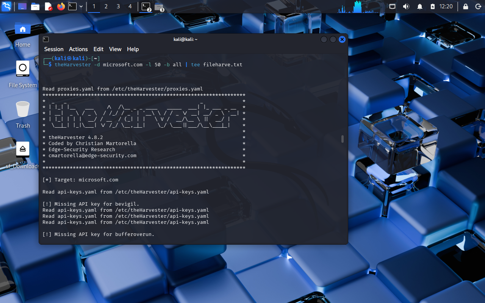

# NETWORKWALKS-ALBERT-STEPHEN-WEEK2-PM4-5-PM-FINAL
 W2-PM4-Footprinting-Recon-theHarvester
# W2-PM4 | Week 2 - Project Module 4
## Footprinting & Reconnaissance Attacks with theHarvester

> **Cybersecurity Ethical Hacking - For Educational Purposes Only!**
> **Network Scanning with Zenmap | Footprinting
> **Source:** NetworkWalks.com 

##  Tools Used

|Name  |Albert Dominic Stephen |
| --- | --- |
| **Program** | B082-Networkwalks |
| **Modules** | `Wk2-PM4-Footp with theHarvester` & `W2-PM5-Network Sc with Zenmap` |
| **Target** | `My own LAN`, `microsoft.com` |

---

## 📋 Project Overview

This project demonstrates **passive Footprinting & Reconnaissance** on a target organization `microsoft.com` using **theHarvester** tool in **Kali Linux**.

theHarvester is a footprinting tool used for gathering information such as emails, sub-domains, hosts, employee names, open ports and banners from different public sources like search engines, PGP key servers and SHODAN computer database. It is developed in Python and comes pre-installed in Kali Linux.

The goal is to understand what an attacker can learn about an organization **without ever touching the target directly** - using only public data.

> ⚠️ **Disclaimer:** This lab is for educational purposes only. Do NOT use this against any domain you do not have permission to test. Always practice on authorized targets.

---

## 🎯 Objectives

- Understand passive reconnaissance and footprinting
- Use theHarvester to gather emails & sub-domains for `microsoft.com`
- Compare results from a single source (Baidu) vs all sources
- Analyze how harvested data can be used in phishing / attack planning and how defenders can reduce leakage

---

## 🛠️ Tools Used

| Tool / OS | Details |
| --- | --- |
| **OS** | Kali Linux |
| **Tool** | theHarvester (Pre-installed in Kali) |
| **Target Domain** | `microsoft.com` |

### Supported Sources in theHarvester:
`baidu, bevigil, bitbucket, brave, bufferoverun, builtwith, censys, certspotter, chaos, commoncrawl, criminalip, crtsh, dehashed, dnsdumpster, duckduckgo, fofa, fullhunt, github-code, git, haveibeenpwned, hudsonrock, hunter, hunterhow, intelx, leakix, leaklookup, netlas, onyphe, otx, pentesttools, projectdiscovery, rapiddns, robtex, rocketreach, securityscorecard, security, subdomaincenter, subdomainfinderc99, thc, threatcrowd, tomba, urlscan, venacus, virustotal, waybackarchive, whoisxml, windvane, yahoo, zoomeye`

---
## ✅ TASKS
Task 1: Find email IDs & sub-domains related to microsoft.com using Baidu - Limit 1000
Goal: Find email IDs & sub-domains related to a target organization microsoft.com using the theHarvester tool in Kali Linux with Baidu. Set the limit of number of results to 1000.
## SOLUTION - Task 1
- STEP 1: Open theHarvester tool in Kali Linux from the menu.
- STEP 2: Read the usage instructions & guidelines:bashtheHarvester -h
- STEP 3: In the terminal window, type below command to start theHarvester & search for the required detail using Baidu:bashtheHarvester -d microsoft.com -l 1000 -b baiduFlags Explained:
-d is the target domain-l limits the number of results-b sets the data sourcetheHarvester then extracts the details and shows them on screen. Scroll down to see the emails and hosts.
Save Output:bashtheHarvester -d microsoft.com -l 1000 -b baidu -f Task-1-Baidu/output
- STEP 4: Save the screenshot. Save the output in a text file.

## Prove 

## Task 2: Find email IDs & sub-domains related to microsoft.com using all sources - Limit 50
Goal: Find email IDs & sub-domains related to a target organization microsoft.com using the theHarvester tool in Kali Linux with all sources. Set the limit of number of results to 50.

## Prove 

## 👨‍💻 Author

## Albert
Internship - Cybersecurity Ethical Hacking
Juba, South Sudan
Linkdlin: https://www.linkedin.com/in/albert-stephen-2k26

