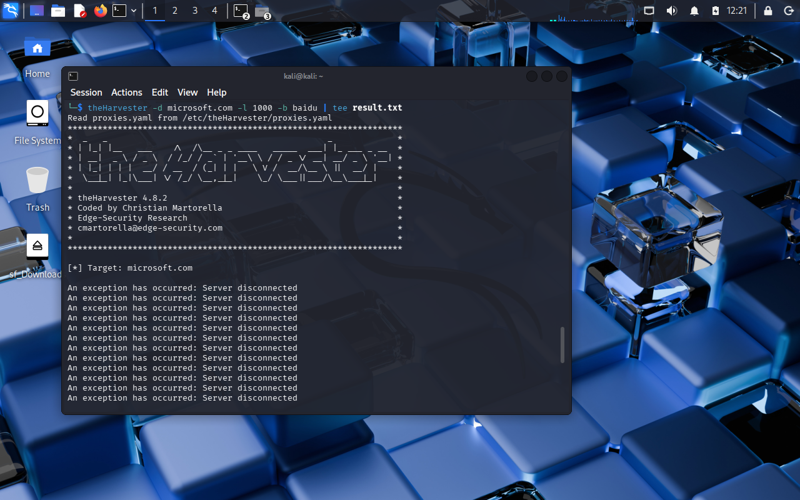
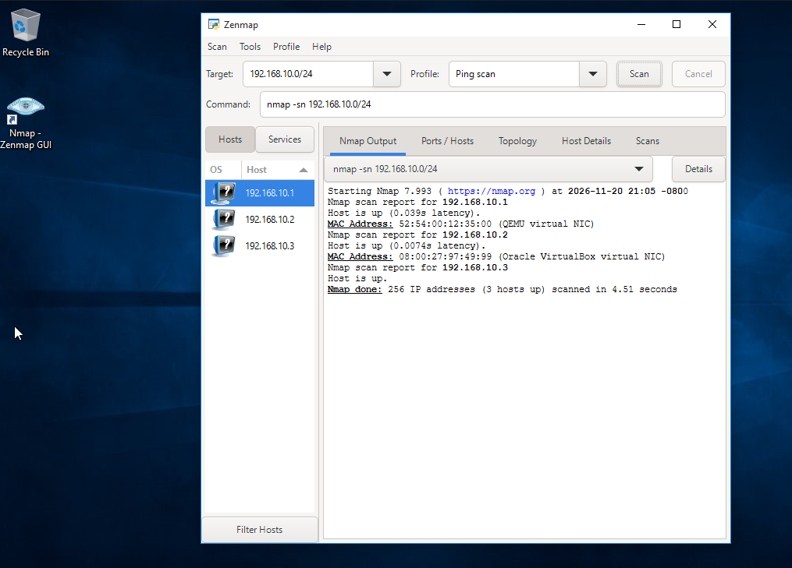
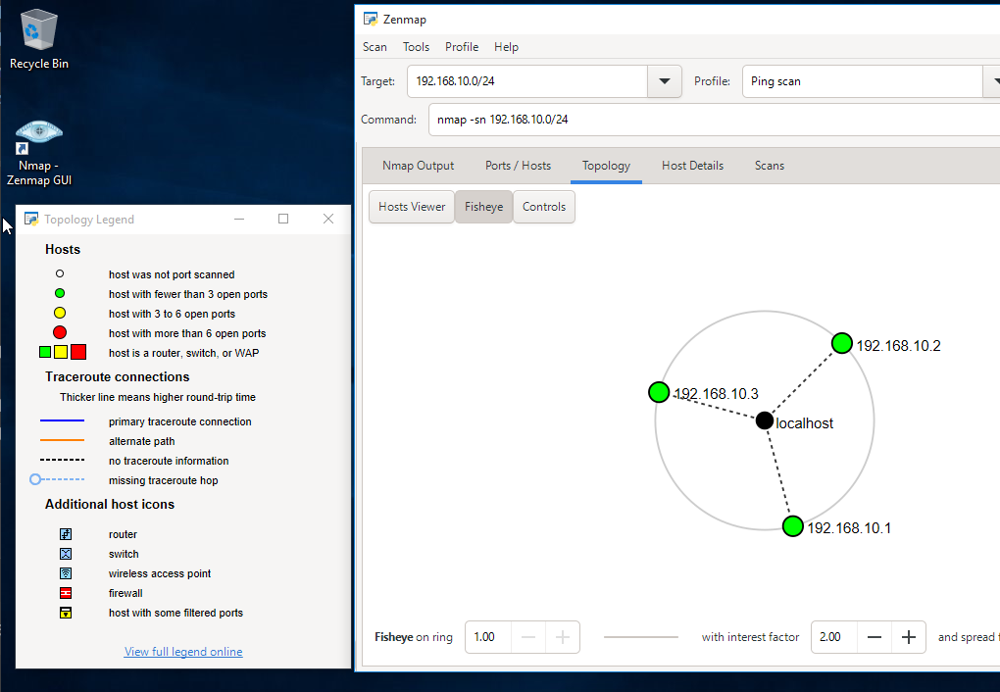

# NETWORKWALKS-ALBERT-STEPHEN-WEEK2-PM4-5-PM-FINAL

## Footprinting & Reconnaissance Attacks with theHarvester

> **Cybersecurity Ethical Hacking - For Educational Purposes Only!**
> **Network Scanning with Zenmap | Footprinting**
> **Source:** NetworkWalks.com 


|Name  |Albert Dominic Stephen |
| --- | --- |
| **Program** | B082-Networkwalks |
| **Modules** | `Wk2-PM4-Footp with theHarvester` & `W2-PM5-Network Sc with Zenmap` |
| **Target** | `My own LAN`, `microsoft.com` |

---

## 📋 Project Report Overview

This project report demonstrates *WK2-PM4* **passive Footprinting & Reconnaissance** on a target organization `microsoft.com` using **theHarvester** tool in **Kali Linux**, and *WK2-PM5* **Network Sc with Zenmap** on a target Network `My own LAN`

**theHarvester** is a footprinting tool used for gathering information such as emails, sub-domains, hosts, employee names, open ports and banners from different public sources like search engines, PGP key servers and SHODAN computer database. It is developed in Python and comes pre-installed in Kali Linux.

The goal is to understand what an attacker can learn about an organization **without ever touching the target directly** - using only public data.

> ⚠️ **Disclaimer:** This lab is for educational purposes only. Do NOT use this against any **`Domain`** or a **`Network`** you do not have permission to test. Always practice on authorized targets.

---

## 🎯 Objectives 

- Understand passive reconnaissance and footprinting
- Use theHarvester to gather emails & sub-domains for `microsoft.com`

- Analyze how harvested data can be used in phishing / attack planning and how defenders can reduce leakage

---

## 🛠️ Tools Used

| Tool / OS | Details |
| --- | --- |
| **OS** | Kali Linux and windows10|
| **Tool** | `theHarvester (Pre-installed in Kali)`, `zenmap` `windowsCLI`|
| **Target Network/Domain** | `microsoft.com` `My own Lan`|


### Supported Sources in theHarvester:
`baidu, bevigil, bitbucket, brave, bufferoverun, builtwith, censys, certspotter, chaos, commoncrawl, criminalip, crtsh, dehashed, dnsdumpster, duckduckgo, fofa, fullhunt, github-code, git, haveibeenpwned, hudsonrock, hunter, hunterhow, intelx, leakix, leaklookup, netlas, onyphe, otx, pentesttools, projectdiscovery, rapiddns, robtex, rocketreach, securityscorecard, security, subdomaincenter, subdomainfinderc99, thc, threatcrowd, tomba, urlscan, venacus, virustotal, waybackarchive, whoisxml, windvane, yahoo, zoomeye`

---
## ✅ TASKS
**Task 1:** Find email IDs & sub-domains related to microsoft.com using Baidu - Limit 1000

**Goal:** Find email IDs & sub-domains related to a target organization microsoft.com using the theHarvester tool in Kali Linux with Baidu. Set the limit of number of results to 1000.
## SOLUTION - Task 1
*STEP 1*: Open theHarvester tool in Kali Linux from the menu.

*STEP 2:* Read the usage instructions &
guidelines:bashtheHarvester -h

*STEP* 3: In the terminal window, type below command to start theHarvester & search for the required detail using Baidu:
bash
```
theHarvester -d microsoft.com -l 1000 -b baidu
```
**Explained:**
-d is the target domain -l limits the number of results-b sets the data sourcetheHarvester then extracts the details and shows them on screen. Scroll down to see the emails and hosts.
Save Output:
``bashtheHarvester -d microsoft.com -l 1000 -b baidu -f Task-1-Baidu/output``

Alternatively you could also use:-
```
theHarvester -d microsoft.com -l 1000 -b baidu | tee output.txt
```
it would run the scan and save the terminal out to output.txt

STEP 4: Save the screenshot. Save the output in a text file.

## Prove 


## Task 2: Find email IDs & sub-domains related to microsoft.com using all sources - Limit 50
Goal: Find email IDs & sub-domains related to a target organization microsoft.com using the theHarvester tool in Kali Linux with all sources. Set the limit of number of results to 50.

## Prove 


# **Network Scanning with Zenmap**
*`This module`* Indicates that i Scan my own LAN / home network, discover all live hosts, and map the network topology.

# Brief about Zenmap
**Zenmap** is the official GUI version of **Nmap** for Windows PC. It is a free, open-source, multi-platform security scanner used by Cybersecurity professionals & Hackers.

It makes Nmap easy for beginners with a graphical interface, while still providing advanced features for experienced users. Frequently used scans can be saved as Profiles to run them repeatedly.

`my approach` in this module was, i  first:
1. Press `Win + R` > type `cmd` > Enter
2. Run:
```cmd
ipconfig
```
  3. Identify my network subnet

  4. Entered the subnet into Zenmap and selected Ping Scan to identify active hosts.
  ```cmd
 nmap -sn 192.168.10.0/24
  ```


## Sample Results 

```
Starting Nmap 7.993 ( https://nmap.org ) at 2026-11-20 21:05 -0800
Nmap scan report for 192.168.10.1
Host is up (0.039s latency).
MAC Address: 52:54:00:12:35:00 (QEMU virtual NIC)
Nmap scan report for 192.168.10.2
Host is up (0.0074s latency).
MAC Address: 08:00:27:97:49:99 (Oracle VirtualBox virtual NIC)
Nmap scan report for 192.168.10.3
Host is up.
Nmap done: 256 IP addresses (3 hosts up) scanned in 4.51 seconds

```

 ## Prove
 *live host*



*topology*




## 🧠 What I Learned

**Zenmap** makes Nmap easy with GUI, profiles, and topology view.Every device on a LAN has an IP (logical) + MAC (physical) address.A Ping Scan -sn is the fastest way to find live hosts without being noisy.The topology view shows how devices are connected to the router.An attacker on same WiFi can see all devices - that's why we must secure 
WiFi with strong password + WPA2/WPA3.

## 🛡️ Defensive Perspective

* Use strong WiFi password + WPA3Change default router admin passwordDisable WPS on router
* Enable MAC filtering for important devicesTurn off unused devices / Guest network for visitors
* Regularly scan your own network to spot unknown devices

## 👨‍💻 Author

### *Albert*

Internship - Cybersecurity Ethical Hacking


**NETWORKWALKS**

Linkedln: https://www.linkedin.com/in/albert-stephen-2k26

